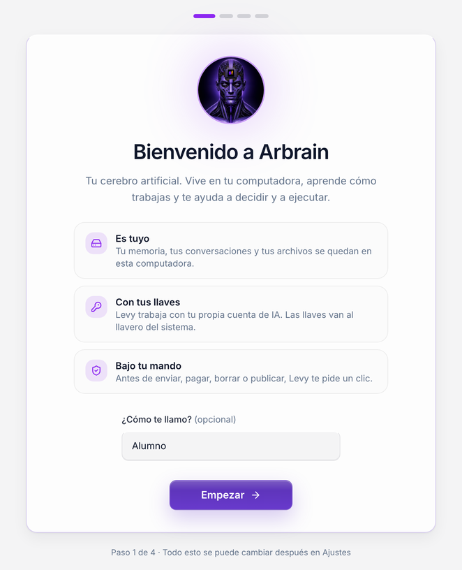
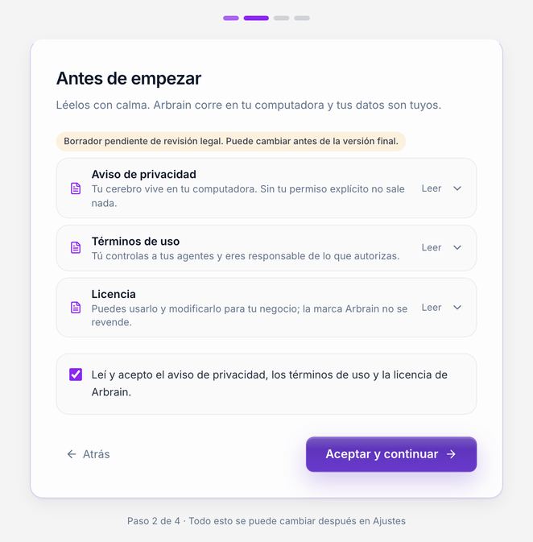
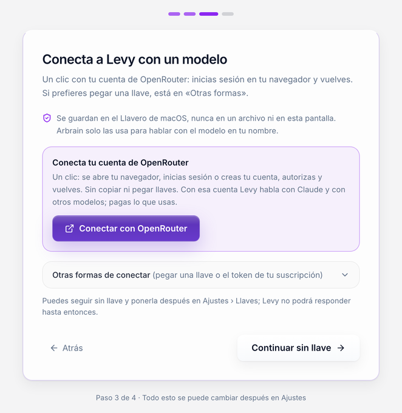
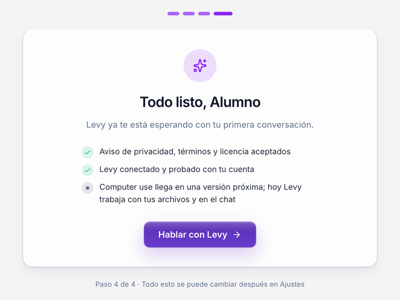
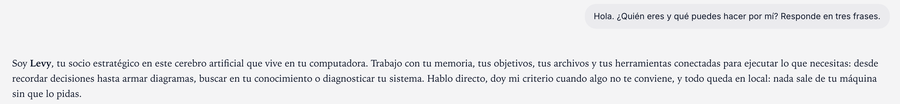

# Instala Arbrain en 10 minutos

Arbrain es tu cerebro artificial: una app de escritorio con tu propio agente, **Levy**, que vive en tu computadora.
Esta guía te lleva de cero a tu primera conversación con Levy. No necesitas saber programar ni instalar nada antes:
el instalador trae todo.

**Lo único que necesitas:** una computadora con macOS, Windows o Linux, internet y **una cuenta de OpenRouter con
crédito** para que Levy hable con Claude. La conectas desde la app con un clic (paso 1).

| Paso | Qué haces | Tiempo |
|---|---|---|
| [1. Tu cuenta](#1-tu-cuenta-de-ia) | Nada que copiar: en el primer arranque conectas OpenRouter con un clic | 0 min |
| [2. Descarga](#2-descarga-arbrain) | Bajas el instalador de tu sistema | 1 min |
| [3. Instala](#3-instala) | Lo abres y pasas el aviso de seguridad | 2 min |
| [4. Primer arranque](#4-primer-arranque-pantalla-por-pantalla) | Cuatro pantallas cortas (cinco en macOS y Windows) y un login en tu navegador | 2-3 min |
| [5. Habla con Levy](#5-tu-primera-conversación) | Le escribes tu primer mensaje | 1 min |

Si es tu primera vez en OpenRouter, crear la cuenta y cargar crédito puede tomarte unos minutos más.

¿Algo no salió? Ve directo a [Problemas comunes](#problemas-comunes).

**Computer use** (que Levy use tu pantalla, haga clic y escriba en tus apps) viene en **macOS y Windows**, apagado:
lo enciendes en el primer arranque o en **Ajustes › Esta computadora**, y se apaga cada vez que cierras la app. En
Linux no está disponible. **Lo que la app todavía no trae:** edición de video; llega en una versión próxima. Tus
cuentas (Google Calendar y Gmail, Todoist) las conectas tú, con Levy guiándote: los manuales están en
`arbrain/cerebro/manuales/` (pídele a Levy «ayúdame a conectar mi calendario»).

---

## 1. Tu cuenta de IA

Arbrain no trae una cuenta de IA incluida: usas **la tuya** (a esto se le llama BYOK, «trae tu propia llave»). Así
pagas directo a tu proveedor lo que uses y nadie más ve tus conversaciones.

**No tienes que preparar nada ahora.** En el primer arranque (pantalla 3) haces clic en **Conectar con OpenRouter**:
se abre tu navegador, inicias sesión en [openrouter.ai](https://openrouter.ai) o creas tu cuenta (puedes entrar con
Google), autorizas a Arbrain y vuelves a la app. Arbrain recibe tu llave y la guarda sola en el llavero de tu
sistema: no copias ni pegas nada.

Para que Levy responda, tu cuenta de OpenRouter necesita **crédito**. Si no tiene, la app te lo dice y te da el botón
**Recargar crédito en OpenRouter**, que abre [openrouter.ai/settings/credits](https://openrouter.ai/settings/credits).
Empieza con poco: recargas cuando quieras.

<details>
<summary><b>Otras formas</b> (si prefieres pegar una llave tú)</summary>

En la misma pantalla, debajo del botón, abre **Otras formas de conectar**. Ahí puedes pegar:

- **Una llave de OpenRouter** que ya creaste a mano en **Keys** ([openrouter.ai/settings/keys](https://openrouter.ai/settings/keys)). Empieza con `sk-or-`.
- **Una API key de Anthropic**, la empresa que hace Claude: en [console.anthropic.com](https://console.anthropic.com)
  agrega crédito en **Billing** y crea la llave en **API keys** › **Create Key**. Empieza con `sk-ant-api`.

Copia la llave en el momento en que la creas: los proveedores solo la enseñan una vez.

</details>

> **¿Cuánto cuesta?** Depende de cuánto hables con Levy y del modelo. Los precios cambian; revisa la página de
> precios de [OpenRouter](https://openrouter.ai/models) o de [Anthropic](https://www.anthropic.com/pricing).
> Arbrain no te cobra nada por usar tu cuenta.

---

## 2. Descarga Arbrain

Entra a la página de descarga de Arbrain que te dio tu programa y baja **un solo archivo**, el de tu sistema.
Junto a los instaladores está el archivo **`SHA256SUMS`** con la huella de cada uno: úsalo para comprobar que lo
que bajaste es exactamente lo que publicamos (abajo te digo cómo).

| Tu sistema | Archivo que bajas | Requisito |
|---|---|---|
| **macOS** | `Arbrain_<versión>_aarch64.dmg` | Mac con chip Apple (M1 o posterior). ¿Tu Mac es Intel? Esta versión no la soporta todavía: avísale a tu programa. |
| **Windows** | `Arbrain_<versión>_x64-setup.exe` (el `.msi` es para equipos administrados y pide permisos de administrador) | Windows 10 o 11 de 64 bits |
| **Linux (Ubuntu, Debian, Mint, Pop!_OS)** | `Arbrain_<versión>_amd64.deb` | Ubuntu 22.04 o posterior, o equivalente; escritorio con llavero |
| **Linux en ARM (Raspberry Pi 5, equipos ARM)** | `Arbrain_<versión>_arm64.deb` | Ubuntu 22.04 o posterior en ARM de 64 bits |

`<versión>` es un número como `0.1.0`. Otras distribuciones de Linux (Fedora, Arch…) llegan en una versión próxima.

¿No sabes si tu Mac es Apple o Intel? Menú Apple (la manzana, arriba a la izquierda) › **Acerca de esta Mac**: si dice **Chip Apple M…**, es Apple.

#### Cómo abrir la terminal

Algunos pasos de Linux y un par de arreglos piden pegar un comando. Abrir la terminal:

- **macOS:** `Cmd + Espacio`, escribe `Terminal` y Enter.
- **Windows:** clic derecho en Inicio › **Terminal** (o **Windows PowerShell**).
- **Linux:** `Ctrl + Alt + T`, o clic derecho en la carpeta de la descarga › **Abrir en una terminal**.

Pega el comando con `Cmd + V` (macOS), `Ctrl + V` o clic derecho (Windows) o `Ctrl + Shift + V` (Linux), y Enter.

#### Comprueba la huella antes de instalar (1 minuto, recomendado)

Como esta versión todavía no va firmada por Apple ni por Microsoft, la huella es tu garantía de que nadie cambió
el archivo en el camino. Abre la terminal en la carpeta de la descarga y corre:

- **macOS / Linux:** `shasum -a 256 Arbrain_*` (en Linux también sirve `sha256sum Arbrain_*`)
- **Windows (PowerShell):** `Get-FileHash .\Arbrain_*-setup.exe -Algorithm SHA256`

El número largo que sale debe ser **idéntico** al de tu archivo en `SHA256SUMS`. Si no coincide, no lo instales:
bórralo, vuelve a bajarlo y, si sigue sin coincidir, avísale a tu programa.

---

## 3. Instala

Esta versión de Arbrain **todavía no está firmada** por Apple ni por Microsoft (la firma es un certificado de pago
que llegará después). Por eso tu sistema te va a advertir la primera vez. Es normal y se pasa una sola vez. Elige tu
sistema:

- [macOS](#macos)
- [Windows](#windows)
- [Linux](#linux)

### macOS

1. Abre el `.dmg` que bajaste (doble clic).
2. Arrastra **Arbrain** a la carpeta **Aplicaciones**.
3. Abre **Aplicaciones** y haz doble clic en **Arbrain**. macOS te dirá que no puede comprobar la app o que no se
   abrió. Dale **OK** o **Listo** (no a «Mover a la papelera»).
4. Abre **Ajustes del Sistema › Privacidad y seguridad**. Baja hasta **Seguridad**: verás «Se bloqueó el uso de
   "Arbrain"…». Haz clic en **Abrir de todos modos** y confirma con tu contraseña o Touch ID.
5. Arbrain se abre. Las siguientes veces abre normal, sin avisos.

> En macOS 14 (Sonoma) o anterior también sirve: **clic derecho sobre Arbrain › Abrir › Abrir**.

Si macOS dice que la app **«está dañada»**, ve a [Problemas comunes](#problemas-comunes).

### Windows

1. Haz doble clic en `Arbrain_<versión>_x64-setup.exe`.
2. Aparece **«Windows protegió tu PC»** (SmartScreen). Haz clic en **Más información** y después en
   **Ejecutar de todas formas**.
3. Sigue el instalador. No pide permisos de administrador: se instala solo para tu usuario.
4. Si te pide instalar **Microsoft Edge WebView2**, acepta. Es el componente de Microsoft con el que Arbrain dibuja
   su ventana; Windows 11 ya lo trae y en Windows 10 casi siempre también. Necesita internet.
5. Abre **Arbrain** desde el menú Inicio.

**Recomendado antes de tu primera conversación:** instala [Git for Windows](https://git-scm.com/download/win)
(siguiente, siguiente, finalizar; las opciones por defecto están bien). Con él tu Levy puede usar la terminal para
trabajar con tus archivos. Sin él, el chat funciona pero Levy queda muy limitado.

**Opcional:** [Python 3](https://www.python.org/downloads/windows/) (al instalar, marca **Add python.exe to PATH**).
Sin Python, algunos frenos extra de los hooks del agente no corren. El freno principal sí funciona siempre: antes de
enviar, pagar, borrar o publicar, la app te pide un clic.

**Lo que esta versión no trae en Windows** (te lo digo de frente):

- **Terminales que sobreviven al cerrar la app**: en Windows, si cierras Arbrain, cualquier terminal que tu agente
  tenga abierta se cierra con ella.
- **Sandbox de la terminal**: en macOS y Linux, los comandos de solo lectura de Levy corren en una caja aislada (sin
  red y sin poder tocar tus llaves) y no te preguntan. En Windows esa caja no existe, así que **cada comando de terminal
  que Levy quiera correr te pide un clic**, incluso para leer un archivo. La ventana te muestra el comando exacto:
  léelo antes de permitirlo y, si no lo entiendes, rechaza y pregúntale a Levy qué hace.

### Linux

**Con `.deb`** (Ubuntu, Debian, Mint, Pop!_OS). En la carpeta donde lo bajaste, abre una terminal
([cómo](#cómo-abrir-la-terminal)) y corre:

```bash
sudo apt install ./Arbrain_*_amd64.deb   # en ARM: ./Arbrain_*_arm64.deb
```

`apt` instala también lo que haga falta: WebKitGTK y el sandbox de la terminal (`bubblewrap` y `socat`). Después
abre **Arbrain** desde tu menú de aplicaciones.

**Sandbox de la terminal:** con `bubblewrap` y `socat`, los comandos de solo lectura de Levy corren en una caja
aislada (sin red y sin poder tocar tus llaves) y no te preguntan. El `.deb` los instala solo; si algún día los quitas,
reinstálalos así:

```bash
sudo apt install bubblewrap socat   # Ubuntu, Debian, Mint, Pop!_OS
sudo dnf install bubblewrap socat   # Fedora
```

Sin ellos Arbrain funciona igual, pero **cada comando de terminal que Levy quiera correr te pide un clic**, como en
Windows. La ventana te muestra el comando exacto: léelo antes de permitirlo.

**Llavero:** Arbrain guarda tu llave en el llavero del sistema (Secret Service). Ubuntu, Fedora y la mayoría de los
escritorios GNOME ya lo traen. En KDE usa KWallet con el servicio Secret Service activado; en escritorios mínimos
instala `gnome-keyring` (`sudo apt install gnome-keyring`), cierra sesión y vuelve a entrar.

---

## 4. Primer arranque, pantalla por pantalla

Al abrir Arbrain verás unos segundos **«Arrancando tu cerebro artificial…»** mientras se prepara. Si algo falla ahí,
la app te dice qué pasó y qué hacer; el texto técnico queda en **Ver detalles** por si lo pide soporte. Luego llegan
cuatro pantallas (cinco en macOS y Windows, con la de computer use). Todo lo que elijas aquí se cambia después en **Ajustes**.

### Pantalla 1 · Bienvenida



Escribe cómo quieres que Levy te llame (es opcional) y haz clic en **Empezar**.

### Pantalla 2 · Antes de empezar



Aquí están el aviso de privacidad, los términos de uso y la licencia. Ábrelos con **Leer** si quieres el texto
completo. Marca **«Leí y acepto el aviso de privacidad, los términos de uso y la licencia de Arbrain.»** y haz clic
en **Aceptar y continuar**.

### Pantalla 3 · Conecta a Levy con un modelo



1. Haz clic en **Conectar con OpenRouter**. Se abre tu navegador en openrouter.ai.
2. Inicia sesión (o crea tu cuenta) y autoriza a Arbrain en la pantalla de OpenRouter.
3. El navegador dice **«Listo, vuelve a Arbrain»**. Cierra esa pestaña y regresa a la app: tu cuenta ya aparece
   como **Cuenta de OpenRouter · Guardada** y Arbrain prueba la conexión solo.
4. Si ves **«Conexión lista: el modelo respondió…»**, haz clic en **Continuar**. Si dice que tu cuenta **no tiene
   crédito**, usa **Recargar crédito en OpenRouter**, recarga y vuelve a **Ya recargué, probar de nuevo**.

Mientras esperas, la app muestra **«Esperando a que autorices en tu navegador…»** con **Abrir de nuevo** (por si
cerraste la pestaña) y **Cancelar**. Tienes 10 minutos; si pasan, vuelve a hacer clic en el botón.

¿Prefieres pegar una llave? Abre **Otras formas de conectar** (ver el [paso 1](#1-tu-cuenta-de-ia)), elige la opción,
pégala y haz clic en **Guardar**. Si la pegaste en la opción equivocada, la app te avisa cuál es.

Tu llave se guarda en el llavero de tu sistema (Llavero de macOS, Administrador de credenciales de Windows o Secret
Service en Linux), nunca en un archivo ni en la página del navegador. Si aún no quieres conectar nada, puedes darle a
**Continuar sin llave** y hacerlo después en **Ajustes › Llaves**; Levy no podrá responder hasta entonces.

### Pantalla 4 · ¿Levy puede usar tu computadora? (solo macOS y Windows)

<!-- Captura pendiente (0.1.2): esta pantalla volvió el 17 oct 2026 y aún no tiene captura nueva. Al tomarla, guárdala
     como docs/guia/arranque-4-computer-use.png y renombra la de «Todo listo» a arranque-5-listo.png. -->

Computer use deja que Levy mire tu pantalla, haga clic y escriba en tus apps, sin mover tu ratón ni tu teclado.
Viene en **Dejarlo apagado** y te recomiendo dejarlo así para empezar. Haz clic en **Continuar**.

- **Se apaga cada vez que cierras Arbrain.** Si eliges **Encenderlo ahora**, dura solo esta apertura; después lo
  enciendes en **Ajustes › Esta computadora** cuando lo necesites.
- **Lo irreversible siempre te pide tu clic:** enviar, borrar, pagar o publicar. No lo uses con tu banco, pagos,
  impuestos ni cripto (Arbrain bloquea esos sitios).
- **En macOS**, la primera vez que Levy lo use, macOS te pide dos permisos para **«ArbrainManos»**: Accesibilidad y
  Grabación de pantalla. Dalos en Ajustes del Sistema › Privacidad y seguridad.
- **En Windows** no hay permisos extra que dar.
- **En Linux** esta pantalla no aparece: esta versión no trae computer use en Linux.

Cómo probarlo y qué hace y qué no: pídele a Levy «enséñame a usar computer use» (manual
`arbrain/cerebro/manuales/computer-use.md`).

### Pantalla 5 · Todo listo (pantalla 4 en Linux)



<!-- La captura es de la versión anterior: su línea de computer use dice «versión próxima». Retomarla en 0.1.2. -->

Revisa el resumen. Si ves **«Levy conectado y probado con tu cuenta»** (como en la captura), estás listo. El resumen también te
dice cómo quedó computer use (apagado o encendido por esta apertura; en Linux, que no está disponible). Si ves un aviso amarillo
**«Sin llave todavía: ponla en Ajustes › Llaves»**, te falta la llave: ponla antes de hablar con
Levy. Haz clic en **Hablar con Levy**.

---

## 5. Tu primera conversación



Levy te recibe con un mensaje de bienvenida y tres ideas para empezar, cada una con su botón debajo del mensaje.
Toca una (por ejemplo **Entrevístame para conocer mi negocio**) o escríbele lo que quieras.

Si responde, **terminaste**. Tu memoria empieza vacía y se llena conversando.

¿No responde o sale un mensaje de error? Casi siempre es la llave: abre **Ajustes › Llaves** y haz clic en
**Probar conexión**. El mensaje que te dé está en la tabla de [Problemas comunes](#problemas-comunes) con su arreglo.

Antes de enviar, pagar, borrar o publicar algo, Levy se detiene y te pide confirmar con un clic. Sin tu clic, no
pasa.

---

## Problemas comunes

| Lo que ves | Por qué pasa | Cómo se arregla |
|---|---|---|
| macOS: «No se abrió "Arbrain"» o «Apple no puede comprobar…» | La app no está firmada por Apple | **Ajustes del Sistema › Privacidad y seguridad › Abrir de todos modos** ([paso 3](#macos)) |
| macOS: «"Arbrain" está dañado y no se puede abrir» | macOS marcó la descarga en cuarentena | En Terminal: `xattr -dr com.apple.quarantine /Applications/Arbrain.app` y ábrela otra vez |
| Windows: «Windows protegió tu PC» | SmartScreen no conoce la app sin firma | **Más información › Ejecutar de todas formas** |
| Windows: la ventana se queda en blanco | Falta Microsoft Edge WebView2 | Instala el **Evergreen Bootstrapper** de [developer.microsoft.com/microsoft-edge/webview2](https://developer.microsoft.com/microsoft-edge/webview2/) y abre Arbrain de nuevo |
| Windows: el antivirus borra o bloquea Arbrain | Algunos antivirus desconfían de apps sin firma | Restáurala desde la cuarentena del antivirus y márcala como permitida |
| Linux: «Tu sistema no tiene un llavero disponible» | No hay Secret Service corriendo | Instala `gnome-keyring` (o activa KWallet), cierra sesión, vuelve a entrar y abre Arbrain |
| Se queda en «Arrancando tu cerebro artificial…» o sale un mensaje en rojo | El servicio local de Arbrain no arrancó | Cierra Arbrain del todo y ábrelo otra vez. Si se repite, revisa `daemon.log` ([dónde está](#dónde-viven-tus-datos-y-los-logs)) |
| «No pude hablar con tu Arbrain local. Cierra y vuelve a abrir la app.» | El servicio local se reinició o se cerró | Haz justo eso: cierra y vuelve a abrir |
| En el chat: «Falta tu llave de Claude…» | No hay llave guardada | **Ajustes › Llaves** › **Conectar con OpenRouter** (o pega tu llave en **Otras formas**) y **Probar conexión** |
| Se queda en «Esperando a que autorices en tu navegador…» | No se abrió el navegador o cerraste la pestaña | **Abrir de nuevo**; si tampoco, **Cancelar** y vuelve a hacer clic en **Conectar con OpenRouter** |
| El navegador dice «Este enlace ya se usó o venció» | Pasaron más de 10 minutos o volviste a abrir un enlace viejo | Vuelve a Arbrain y haz clic otra vez en **Conectar con OpenRouter** |
| «La llave no es válida o venció» | Se copió incompleta o se borró en tu proveedor | Crea una nueva en tu proveedor, quita la vieja en **Ajustes › Llaves** y pega la nueva |
| «Tu cuenta quedó conectada, pero todavía no tiene crédito» | Tu cuenta de OpenRouter o Anthropic está en cero | **Recargar crédito** (el botón abre la página de tu proveedor) y luego **Ya recargué, probar de nuevo** |
| «Claude está saturado en este momento» | Alta demanda del proveedor | Tu llave está bien: espera un minuto |
| Un navegador muestra «Abre Arbrain desde la app» | Abriste la dirección local en el navegador | Por seguridad solo responde a la app: usa la ventana de Arbrain |
| Windows: Levy dice que no puede usar la terminal | Falta Git for Windows | Instala [Git for Windows](https://git-scm.com/download/win) y reinicia Arbrain |
| Levy dice que computer use está apagado | Se apaga cada vez que cierras la app | Enciéndelo en **Ajustes › Esta computadora** (solo macOS y Windows) |
| macOS: Levy no ve tu pantalla o no puede hacer clic | Faltan los permisos de «ArbrainManos» | **Ajustes del Sistema › Privacidad y seguridad › Accesibilidad** y **› Grabación de pantalla y audio del sistema**: enciende «ArbrainManos», cierra Arbrain por completo y ábrelo otra vez |

¿Nada de esto? Pide ayuda en tu programa y adjunta tu `daemon.log` (revísalo antes: no debería tener tus llaves,
pero sí puede tener nombres de tus archivos).

### Dónde viven tus datos y los logs

Todo vive en una carpeta de tu usuario:

| Sistema | Carpeta de Arbrain |
|---|---|
| macOS | `~/Library/Application Support/ai.arbrain.app/` (en Finder: **Ir › Ir a la carpeta…** y pega la ruta) |
| Windows | `%APPDATA%\ai.arbrain.app\` (pégalo en la barra del Explorador de archivos) |
| Linux | `~/.local/share/ai.arbrain.app/` (y algunos ajustes en `~/.config/ai.arbrain.app/`) |

Dentro encuentras:

| Carpeta | Qué guarda |
|---|---|
| `cerebro/` | **Tu cerebro**: la memoria de Levy, sus instrucciones y tus archivos de trabajo. Respáldala. |
| `web/` | Tus conversaciones y tus lienzos |
| `daemon/` | El estado del servicio local (base de datos, configuración, adjuntos) |
| `logs/daemon.log` | El registro del servicio local. Es el que pide soporte. |

Tus llaves **no** están en esa carpeta: están en el llavero del sistema, con el nombre `ai.arbrain.app`.

---

## Desinstalar

1. **Quita tus llaves primero** (recomendado): **Ajustes › Llaves › Quitar** en cada una. Si ya desinstalaste,
   búscalas como `ai.arbrain.app` en **Acceso a Llaveros** (macOS), **Administrador de credenciales › Credenciales
   de Windows** (Windows) o **Contraseñas y claves / Seahorse** (Linux) y bórralas ahí.
2. **Quita la app:**
   - macOS: arrastra **Arbrain** de Aplicaciones a la papelera.
   - Windows 11: **Configuración › Aplicaciones › Aplicaciones instaladas › Arbrain › ⋯ › Desinstalar**.
     Windows 10: **Configuración › Aplicaciones › Aplicaciones y características › Arbrain › Desinstalar**.
   - Linux: `sudo apt remove arbrain` (instalado con el `.deb`).
3. **Tus datos se quedan** en la carpeta de [arriba](#dónde-viven-tus-datos-y-los-logs) para que no pierdas tu
   cerebro por accidente. Si de verdad quieres borrar todo, respalda `cerebro/` si lo quieres conservar y luego borra
   esa carpeta a mano.

---

## Privacidad en cinco líneas

1. Tu cerebro, tus conversaciones y tus archivos viven en tu computadora; nadie más tiene acceso.
2. Lo que le escribes a Levy viaja solo al proveedor que tú elegiste (OpenRouter o Anthropic), con tu llave.
3. Tus llaves viven en el llavero de tu sistema, nunca en un archivo.
4. Arbrain solo escucha dentro de tu computadora: no abre puertas a internet ni túneles.
5. El monitoreo del programa viene apagado; si lo enciendes, solo salen cifras y lo apagas en **Ajustes › Privacidad**.

Los textos legales completos están en **Ajustes › Privacidad**. Son un borrador pendiente de revisión legal y pueden
cambiar antes de la versión final.
