<div align="center">

<picture>
  <source media="(prefers-color-scheme: dark)" srcset=".github/assets/hero-oscuro.svg">
  <source media="(prefers-color-scheme: light)" srcset=".github/assets/hero-claro.svg">
  
</picture>

<br>

[](LICENSE)
[](https://github.com/arbrain-ai/arbrain/releases)
[](https://nodejs.org)
[](#instalar)
[](https://claude.com/claude-code)

**[arbrain.ai](https://arbrain.ai)** · **[YouTube](https://www.youtube.com/channel/UCX4AjkMDukOaj0eqr0FIS5g)** · **[Instalar](#instalar)** · **[Cambios](CHANGELOG.md)** · **[Contribuir](#contribuir)**

</div>

<br>

## Qué es

**Arbrain es tu cerebro artificial: un bucle hacia tu meta.** Le dices a dónde quieres llegar y tu agente, **Levy**,
lo convierte en un plan de mes, semana y día; lo agenda, lo ejecuta contigo, revisa qué se cumplió y ajusta. Cada
vuelta del bucle sabe más de ti, porque todo lo que aprende queda escrito en tu memoria.

No es un chat más. El chat es la punta del iceberg. Debajo hay un sistema nervioso completo que corre en **tu**
computadora: memoria, habilidades, rutinas y manos, conectados al mejor modelo disponible.

## Por qué

- **La punta mejora sola.** El modelo (Claude u otro) mejora cada pocos meses y Arbrain lo usa el mismo día. No tienes
  que reconstruir nada.
- **Lo de abajo es tuyo.** Tu memoria, tus habilidades y tus rutinas son archivos de texto en tu disco, versionados
  en git. Los puedes leer, editar, respaldar y llevar a otro lado. Nadie te los puede quitar.
- **Crece con la IA.** Cuanto mejor es el modelo, más rinde lo que construiste alrededor. Lo que hoy le enseñas a tu
  Levy sigue sirviendo con el modelo de dentro de cinco años.

<br>

<picture>
  <source media="(prefers-color-scheme: dark)" srcset=".github/assets/arquitectura-oscuro.svg">
  <source media="(prefers-color-scheme: light)" srcset=".github/assets/arquitectura-claro.svg">
  
</picture>

## Funciones

<table>
<tr>
<td width="50%" valign="top">

<b>Memoria</b><br>
Lo que Levy sabe de ti, de tu negocio y de tu meta, en archivos Markdown. Recuerda decisiones y correcciones entre
conversaciones.
</td>
<td width="50%" valign="top">

<b>Habilidades</b><br>
Skills que enseñan a Levy a hacer un trabajo de principio a fin. Vienen varias y creas las tuyas hablando.
</td>
</tr>
<tr>
<td valign="top">

<b>Rutinas</b><br>
Revisiones del día, la semana y el mes que Levy corre contigo, y ganchos que en cada sesión le cargan tu agenda y tu
memoria.
</td>
<td valign="top">

<b>Calendario y hábitos</b><br>
Día, semana y mes en tu panel. «Agéndame…» o «agrega el hábito…» y Levy lo escribe en tu plan local, con rachas.
</td>
</tr>
<tr>
<td valign="top">

<b>Voz</b><br>
Dicta en lugar de escribir (con tu llave gratuita de Groq) y escucha las respuestas con la voz de tu dispositivo.
</td>
<td valign="top">

<b>Lienzos</b><br>
Una pizarra donde Levy dibuja mapas, planes y diagramas que tú editas a mano. Arranca con «Mi plan» y «12 semanas».
</td>
</tr>
<tr>
<td valign="top">

<b>Panel</b><br>
Chat, calendario, lienzo, explorador de archivos y taller en una sola ventana del navegador.
</td>
<td valign="top">

<b>Manos</b><br>
Levy usa tu computadora y la web por ti en macOS y Windows. Viene apagado y siempre pide permiso para lo irreversible.
</td>
</tr>
</table>

## Instalar

Necesitas **Git**, **Node 22** o más nuevo, **Python 3** y, para el camino recomendado,
**[Claude Code](https://claude.com/claude-code)** con tu propia cuenta. Funciona en macOS, Windows y Linux.

### Camino 1 · Con Claude Code (recomendado)

Abre Claude Code en tu carpeta personal y pega esta línea:

```text
Instala Arbrain siguiendo https://github.com/arbrain-ai/arbrain/blob/main/INSTALAR.md
```

Tu Claude revisa tu equipo, respalda lo que ya tengas (la app 0.1.x, tu Business OS o tu propio repo) y lo trae a tu
capa sin borrar nada, clona Arbrain, lo arranca y te guía con tu llave, tu voz, tu meta y tu primer hábito. El guion
completo está en [`INSTALAR.md`](INSTALAR.md).

<details>
<summary>Alternativa: el prompt corto, pegado completo</summary>

```text
Instala Arbrain, mi cerebro artificial, desde https://github.com/arbrain-ai/arbrain en ~/Arbrain.

Reglas: no borres ni sobrescribas nada que ya exista (si algo choca, enséñamelo y
pregúntame). Nunca me pidas, leas ni muestres llaves, tokens o contraseñas. Antes de
cada comando, dime en una línea qué hace.

1. Revisa que tenga git, Node 22 o más nuevo, npm y Python 3.
   Si falta algo, dime cómo instalarlo y espera.
2. Si ~/Arbrain no existe, clónalo:
   git clone --origin dani https://github.com/arbrain-ai/arbrain.git ~/Arbrain
   Si ya existe, no lo toques: dime qué hay y pregúntame qué hacer.
3. En ~/Arbrain crea mi rama de trabajo: git switch -c mi-arbrain
4. Siembra mi capa sin pisar nada: python3 arbrain/cerebro/sembrar.py
   y guárdala con un commit en mi-arbrain.
5. Arranca Arbrain: cd arbrain && npm run servidor
   (la primera vez instala y compila; tarda unos minutos).
6. Cuando abra el navegador, guíame para conectar mi llave del chat en Ajustes.
7. Pregúntame mi meta del mes, de la semana y de hoy, y escríbelas en
   .claude/plan/objetivos.md.
```

</details>

### Camino 2 · Manual

```bash
git clone --origin dani https://github.com/arbrain-ai/arbrain.git ~/Arbrain
cd ~/Arbrain
git switch -c mi-arbrain                # tu rama: aquí vive todo lo tuyo
python3 arbrain/cerebro/sembrar.py      # siembra tu capa sin pisar nada
cd arbrain && npm run servidor          # instala, compila y abre tu navegador
```

Arbrain queda en `http://127.0.0.1` (solo en tu computadora). Comandos útiles, desde `~/Arbrain/arbrain`:

| Comando | Qué hace |
|---|---|
| `npm run servidor` | Arranca Arbrain y abre el navegador con tu sesión |
| `npm run servidor -- estado` | Dice si está corriendo y en qué dirección |
| `npm run servidor -- detener` | Lo apaga |
| `npm run servidor -- contrasena` | Muestra la contraseña para entrar desde otro navegador |
| `npm run servidor -- arranque-automatico activar` | Lo arranca solo al encender la computadora |

> El remoto se llama `dani` a propósito: es de donde llegan las versiones nuevas. Si quieres respaldar tu rama en tu
> propio GitHub, agrega tu repositorio privado como `origin`.

## Actualizar

Abre Claude Code en `~/Arbrain` y dile:

> **«jala los últimos cambios»**

La habilidad `actualizar-arbrain` respalda tu rama, te explica en cinco líneas qué trae la versión nueva según el
[`CHANGELOG.md`](CHANGELOG.md), la integra en `mi-arbrain` sin tocar tu capa, siembra lo nuevo y reinicia Arbrain.
Si un archivo que editaste choca con uno del autor, te enseña los dos lados y te pregunta.

A mano: `git fetch dani --tags && git switch main && git merge --ff-only dani/main && git switch mi-arbrain && git merge main`.

## Suscripción: tu cuenta de Claude

Cada cuenta de Claude es **individual** y se usa en **tu propio Claude Code**, con tu sesión (Pro, Max o tu asiento
de Team). Es la forma principal de trabajar con tu cerebro.

El chat dentro de Arbrain usa **tu propia llave**: OpenRouter o una API key de Anthropic, que conectas en Ajustes.
Arbrain nunca pide, guarda ni usa credenciales de tu suscripción, y no comparte cuentas entre personas
([condiciones de Anthropic](https://code.claude.com/docs/en/legal-and-compliance)).

## Estructura de capas

Hay dos capas y nunca se pisan. La del autor llega con cada versión; la tuya nace una sola vez de la semilla y vive
en tu rama.

| Capa | Rutas | Quién la cambia |
|---|---|---|
| **Tuya** | `.claude/memory/`, `.claude/plan/` (objetivos, calendario, hábitos), `.claude/now.md`, `.claude/diario/`, `.claude/daily/`, `.claude/knowledge/`, tus skills en `.claude/skills/`, `CLAUDE.local.md`, `mi-negocio/` | Tú y tu Levy, en `mi-arbrain` |
| **Del autor** | `CLAUDE.md`, las skills que vienen con Arbrain, los ganchos, `arbrain/` (el código) y la semilla | Cada versión, en `main` |

```text
~/Arbrain
├── CLAUDE.md                 contrato de Levy (importa tu memoria)
├── CAPAS.json                la lista exacta de qué es tuyo y qué del autor
├── .claude/
│   ├── memory/               tu memoria            ← tuya
│   ├── plan/                 objetivos, calendario y hábitos  ← tuya
│   ├── skills/               habilidades del autor y las tuyas
│   └── hooks/                rutinas que cuidan tu memoria
└── arbrain/
    ├── cerebro/semilla/      de aquí nace tu capa la primera vez
    ├── scripts/servidor.mjs  npm run servidor
    ├── server/               el servicio local de Levy
    └── src/                  el panel (Next.js)
```

Si quieres que tu Levy sepa o haga algo distinto, escríbelo en tu memoria (`.claude/memory/MEMORY.md`) o en una skill
tuya, no en `CLAUDE.md`: así las actualizaciones nunca chocan con lo tuyo.

## Seguridad por defecto

- Todo escucha solo en `127.0.0.1`. No hay túneles ni puertos abiertos hacia afuera.
- Tus llaves viven en un archivo privado de tu carpeta de datos, nunca en el repositorio.
- Enviar, borrar, pagar o publicar siempre pide tu confirmación.
- El control de la computadora viene apagado y se enciende en Ajustes.
- La telemetría está apagada salvo que tú la aceptes.

## Contribuir

Las ideas, los reportes y los PR son bienvenidos.

1. Abre un [issue](https://github.com/arbrain-ai/arbrain/issues) con lo que viste o lo que propones.
2. Para código: haz un fork, crea una rama desde `main` y abre un PR pequeño y con una sola idea.
3. No incluyas datos personales, llaves ni archivos de la capa del usuario (`CAPAS.json`); la CI revisa esto último.

Este repositorio se publica por versiones: los PR aceptados se integran en la siguiente versión y aparecen en el
[`CHANGELOG.md`](CHANGELOG.md). Si encuentras una vulnerabilidad, repórtala en privado desde la pestaña
**Security** del repositorio, no en un issue público.

## Licencia

[Apache-2.0](LICENSE). Puedes usar, modificar y distribuir Arbrain, también con fines comerciales, conservando el
aviso de licencia y el [`NOTICE`](NOTICE). El nombre y el logo de Arbrain son marcas de su autor.

<br>

<div align="center">

**[arbrain.ai](https://arbrain.ai)** · **[YouTube](https://www.youtube.com/channel/UCX4AjkMDukOaj0eqr0FIS5g)**

<sub>Hecho con Claude Code, para quien quiere un cerebro propio y no uno rentado.</sub>

</div>
